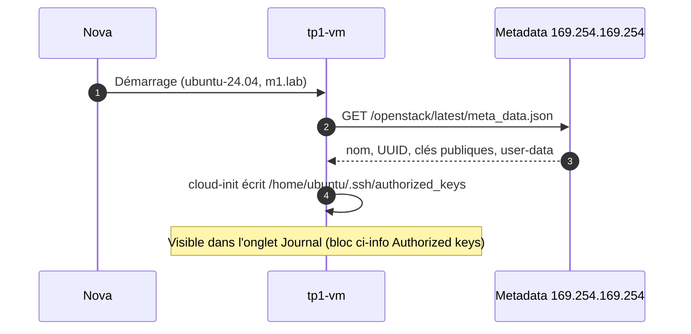
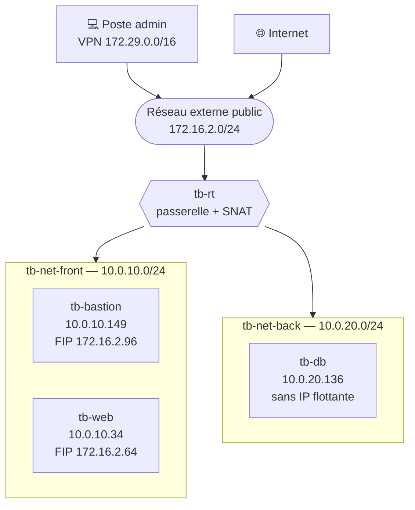
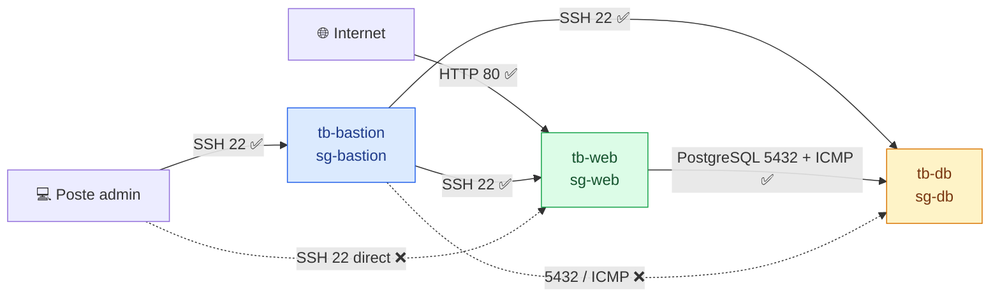
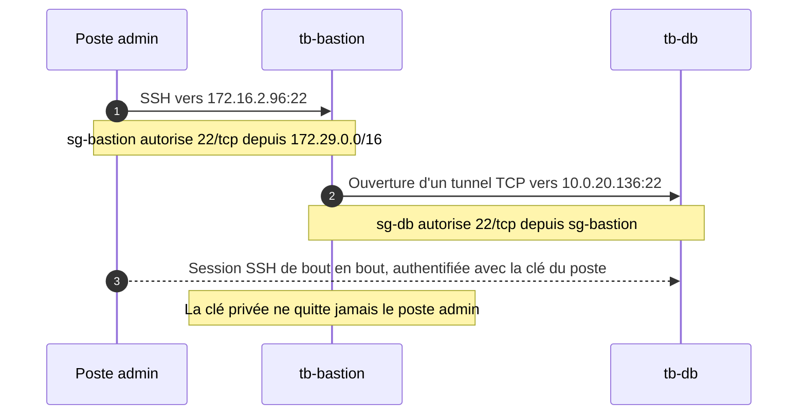

# ☁️ Module Cloud — OpenStack

> **Formation** : Administrateur d'Infrastructures Sécurisées (AIS) — Bac+3
> **Auteur** : Elhadj Messaoui
> **Date** : 18/11/2026
> **Plateforme** : cloud OpenStack de l'école, projet `ais-elhadj.messaoui`, accès via VPN

Fil rouge du module : héberger **TaskBoard** (PostgreSQL + API + front nginx, réalisé au module Docker) sur OpenStack. Les TP1 et TP2 posent les fondations : prise en main d'Horizon, accès SSH, puis réseau segmenté et firewall.

## Sommaire

- [Environnement](#environnement)
- [TP1 — Découverte du cloud via Horizon](#tp1--découverte-du-cloud-via-horizon)
- [TP2 — Réseau segmenté et firewall](#tp2--réseau-segmenté-et-firewall)
- [Incidents rencontrés et résolutions](#incidents-rencontrés-et-résolutions)
- [Leçons retenues](#leçons-retenues)

---

## Environnement

| Élément | Valeur |
|---|---|
| Console Horizon | `http://172.16.1.204/openstack-horizon` |
| Domaine / projet | `ecole` / `ais-elhadj.messaoui` |
| Réseau externe | `public` — `172.16.2.0/24` |
| Image | `ubuntu-24.04` (utilisateur `ubuntu`) |
| Gabarit | `m1.lab` — 1 vCPU / 1 Go / 10 Go |
| IP d'administration (VPN) | `172.29.0.0/16` |
| Quotas | 6 instances · 8 vCPU · 10 Go RAM · 6 volumes / 40 Go · 4 IP flottantes |

---

## TP1 — Découverte du cloud via Horizon

### Ce qui a été réalisé

1. Exploration du projet : quotas, images, gabarits, topologie (seul le réseau externe `public` existait).
2. Import de la **clé publique** SSH dans *Compute → Paires de clés* (`cle-messaoui`).
3. Création de `tp1-net` (`10.99.0.0/24`) et du routeur `tp1-rt` relié à `public`.
4. Lancement de `tp1-vm` (`ubuntu-24.04`, `m1.lab`, disque éphémère).
5. Association d'une IP flottante → SSH en **timeout** → ajout d'une règle SSH depuis `172.29.0.0/16` dans le groupe `default` → connexion OK.
6. Observation du service de métadonnées depuis la VM.
7. Nettoyage complet.

### Démarrage d'une instance et injection de la clé



### Ordre de nettoyage


### Réponses aux questions

| Question | Réponse |
|---|---|
| Qui définit image, gabarit, réseau externe, quotas ? | **L'opérateur du cloud.** L'utilisateur crée ce qui vit dans son projet : réseaux privés, routeurs, instances, clés, groupes de sécurité. |
| Pourquoi ne jamais importer la clé privée ? | Elle est le secret qui prouve l'identité. Le serveur n'a besoin que de la clé publique (déposée dans `authorized_keys`). Transmettre la clé privée revient à la compromettre. |
| Pourquoi le premier SSH échoue ? | Les groupes de sécurité refusent tout trafic entrant par défaut. Le groupe `default` n'autorise que le trafic entre ses membres : le paquet est jeté, d'où un **timeout** et non un refus. |
| À quoi sert `169.254.169.254` ? | C'est le **service de métadonnées** : l'instance y récupère son identité, ses clés publiques et ses user-data. cloud-init l'interroge au démarrage. Adresse link-local, interceptée par Neutron. |
| Pourquoi libérer l'IP flottante explicitement ? | Elle est allouée au **projet**, pas à l'instance. Supprimer la VM la dissocie seulement : elle continue de consommer le quota et une adresse du pool public partagé (et serait facturée sur un cloud public). |

> 💡 `ip a` dans la VM ne montre que l'IP privée : l'IP flottante est traduite par le routeur (NAT 1:1), la VM ne la connaît pas.

---

## TP2 — Réseau segmenté et firewall

Objectif : construire une architecture segmentée **uniquement via Horizon**, avec un bastion comme point d'entrée unique.

### Architecture



### Réseaux

| Réseau | Sous-réseau | CIDR | DNS |
|---|---|---|---|
| `tb-net-front` | `tb-subnet-front` | `10.0.10.0/24` | `1.1.1.1` |
| `tb-net-back` | `tb-subnet-back` | `10.0.20.0/24` | `1.1.1.1` |

Routeur `tb-rt` : passerelle externe `public`, une interface sur chaque sous-réseau.

### Groupes de sécurité

| Groupe | Règle entrante | Source |
|---|---|---|
| `sg-bastion` | TCP 22 | `172.29.0.0/16` |
| `sg-web` | TCP 80 | `0.0.0.0/0` |
| `sg-web` | TCP 22 | groupe `sg-bastion` |
| `sg-db` | TCP 5432 | groupe `sg-web` |
| `sg-db` | TCP 22 | groupe `sg-bastion` |
| `sg-db` | ICMP | groupe `sg-web` |

### Matrice des flux



### Instances

| Instance | Réseau | Groupe | IP privée | IP flottante |
|---|---|---|---|---|
| `tb-bastion` | `tb-net-front` | `sg-bastion` | `10.0.10.149` | `172.16.2.96` |
| `tb-web` | `tb-net-front` | `sg-web` | `10.0.10.34` | `172.16.2.64` |
| `tb-db` | `tb-net-back` | `sg-db` | `10.0.20.136` | — |

Toutes : `ubuntu-24.04`, `m1.lab`, disque éphémère, paire de clés `cle-messaoui`, **groupe `default` retiré**.

### Accès SSH par rebond

Configuration côté poste (`C:\Users\messa\.ssh\config`) :

```sshconfig
Host 172.16.2.* 10.0.*.*
    User ubuntu
    IdentityFile ~/.ssh/id_ed25519_openstack
```

```powershell
ssh 172.16.2.96                      # tb-bastion
ssh -J 172.16.2.96 10.0.10.34        # tb-web
ssh -J 172.16.2.96 10.0.20.136       # tb-db
```



### Tests

| # | Test | Depuis | Attendu | Obtenu |
|---|---|---|---|---|
| 1 | `ssh -J` vers `tb-db` | Poste admin | Shell sur `tb-db` | ✅ `ubuntu@tb-db:~$` |
| 2a | `ping 10.0.20.136` | `tb-web` | Réponse | ✅ 0 % de perte |
| 2b | `ping 10.0.20.136` | `tb-bastion` | Bloqué | ✅ 100 % de perte |
| 3a | `nc -vz 10.0.20.136 5432` | `tb-web` | Connexion | ✅ `succeeded!` |
| 3b | `nc -vz 10.0.20.136 5432` | `tb-bastion` | Bloqué | ✅ `timed out` |
| 4 | `ssh ubuntu@172.16.2.64` | Poste admin | Bloqué | ✅ `Connection timed out` |
| 5 | `curl -I https://deb.debian.org` | `tb-db` | Réponse HTTP | ✅ `HTTP/2 200` |

<details>
<summary>Extraits de sorties</summary>

```text
ubuntu@tb-bastion:~$ ping -c 3 10.0.20.136
3 packets transmitted, 0 received, 100% packet loss, time 2063ms

ubuntu@tb-bastion:~$ nc -vz -w 5 10.0.20.136 5432
nc: connect to 10.0.20.136 port 5432 (tcp) timed out: Operation now in progress

ubuntu@tb-web:~$ nc -vz -w 5 10.0.20.136 5432
Connection to 10.0.20.136 5432 port [tcp/postgresql] succeeded!

PS C:\Users\messa> ssh ubuntu@172.16.2.64
ssh: connect to host 172.16.2.64 port 22: Connection timed out

ubuntu@tb-db:~$ curl -I https://deb.debian.org
HTTP/2 200
server: Apache
```

</details>

> 💡 Test 5 : `tb-db` n'a pas d'IP publique mais accède à Internet grâce au **SNAT** du routeur `tb-rt`, qui traduit les adresses privées vers son adresse sur `public`. La sortie fonctionne, l'entrée reste impossible.

### Réponses aux questions

**1. Pourquoi un groupe comme source plutôt que l'IP de `tb-web` ?**
Une source de type groupe est **dynamique** : elle suit toutes les instances membres, quelle que soit leur IP. Recréer `tb-web` (nouvelle IP) ou ajouter un second serveur web ne demande aucune modification des règles. Une IP en dur casse à la première recréation et doit être maintenue à la main.

**2. Que se passerait-il avec une règle SSH `0.0.0.0/0` sur `sg-web` ?**
`tb-web` serait joignable en SSH par quiconque atteint sa FIP : exposition au brute force, contournement du bastion, perte du point d'entrée unique et de la traçabilité. *Observé en pratique* : tant que `default` (SSH ouvert depuis le VPN) était attaché à `tb-web`, le SSH direct fonctionnait, comme en témoigne `Last login ... from 172.29.0.26` (IP VPN du poste) au lieu de `10.0.10.149` (bastion).

**3. Quel rôle Keystone pour un auditeur ? pour un développeur ?**

| Profil | Rôle | Justification |
|---|---|---|
| Auditeur | `reader` | Lecture seule : il consulte, il ne modifie rien. |
| Développeur (projet dev) | `member` | Crée, modifie et supprime les ressources de son projet. |
| — | `manager` | Rôle de gestion supérieur, inutile pour ces profils (moindre privilège). |

---

## Incidents rencontrés et résolutions

| # | Symptôme | Cause | Résolution |
|---|---|---|---| |
| 2 | Instances en **Erreur** — `No valid host was found` (500) | Hyperviseurs saturés (toute la classe lance ses VM en même temps) | Suppression puis relance **une instance à la fois** |
| 3 | « Pas de port disponible » à l'association d'IP flottante | Conséquence du n°2 : instances en erreur, donc sans port réseau | Résolu avec le n°2 |
| 4 | `Permission denied (publickey)` + demande de passphrase | Clé `id_ed25519` protégée par une passphrase inconnue | Nouvelle clé dédiée `id_ed25519_openstack`, import dans `cle-messaoui`, recréation des instances |
| 5 | Connexion en `messa@…` au lieu de `ubuntu@…` | Fichier `~/.ssh/config` enregistré en `config.txt` par Notepad | Recréation via `Set-Content -Encoding ascii`, vérification avec `ssh -G` |
| 6 | `E: Unable to locate package ncat` | Cache `apt` vide sur une image cloud neuve | `sudo apt update` avant l'installation |
| 7 | Le bastion ping et joint le port 5432 de `tb-db` · SSH direct possible sur `tb-web` | Groupe `default` resté attaché aux instances (trafic libre entre membres + SSH depuis le VPN) | Retrait de `default` sur les trois instances |
| 8 | Bastion injoignable après retrait de `default` | L'accès SSH reposait sur `default`, pas sur `sg-bastion` | Vérification et correction de `sg-bastion` (TCP 22 entrant depuis `172.29.0.0/16`) |

---

## Leçons retenues

- **Les groupes de sécurité s'additionnent** : la règle la plus permissive l'emporte. Un groupe oublié (`default`) suffit à casser toute la segmentation.
- **Toujours tester ce qui doit être bloqué**, pas seulement ce qui doit passer : sans les tests négatifs, l'erreur n°7 serait passée inaperçue.
- Le **bastion** est le seul point d'entrée : la clé privée reste sur le poste, le rebond `ssh -J` évite de la copier sur le bastion.
- Une ressource flottante (IP) **vit indépendamment** de l'instance : il faut la libérer explicitement.
- La capacité d'un cloud partagé n'est pas infinie : `No valid host` est un problème opérateur, pas de quota.
