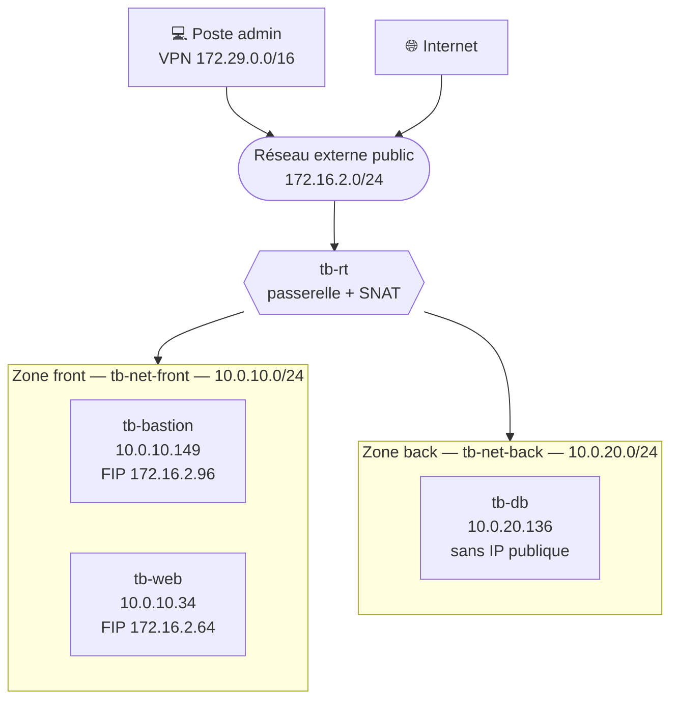
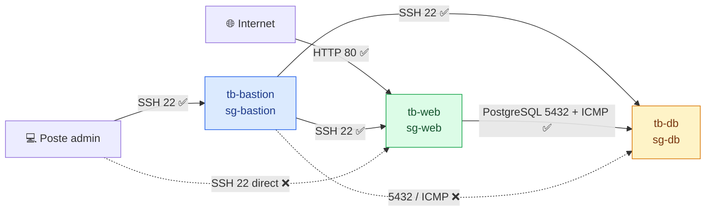
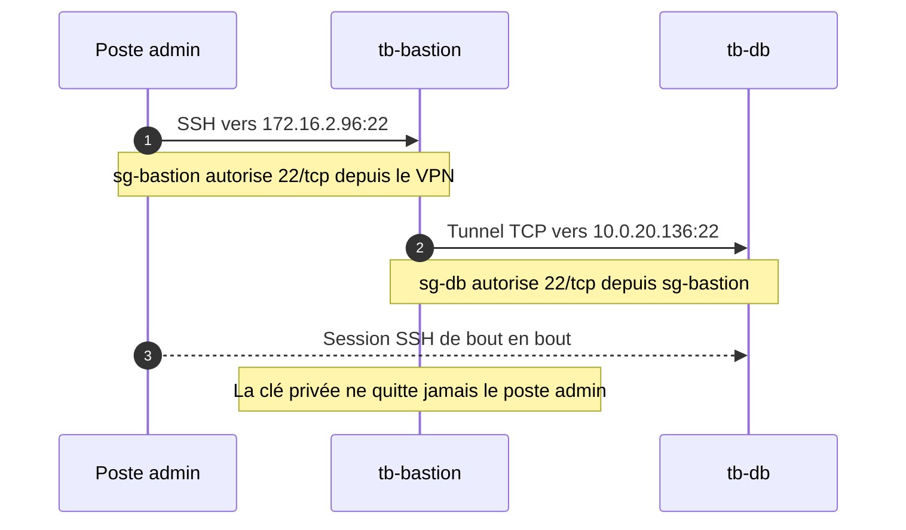
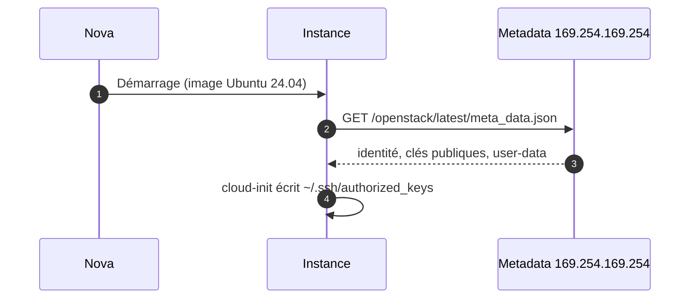

# ☁️ OpenStack Lab — Infrastructure segmentée avec bastion


Lab personnel de montée en compétences sur le **cloud IaaS OpenStack**. L'objectif : concevoir, déployer et sécuriser une infrastructure à 3 tiers (bastion, web, base de données), avec une segmentation réseau stricte et un accès d'administration par rebond.

Ce dépôt documente la démarche complète : architecture, règles de filtrage, validation par tests positifs et négatifs, et résolution des incidents rencontrés.

## Sommaire

- [Objectifs](#objectifs)
- [Compétences mobilisées](#compétences-mobilisées)
- [Architecture](#architecture)
- [Segmentation et filtrage](#segmentation-et-filtrage)
- [Accès d'administration par bastion](#accès-dadministration-par-bastion)
- [Validation](#validation)
- [Troubleshooting](#troubleshooting)
- [Choix de conception](#choix-de-conception)
- [Roadmap](#roadmap)

---

## Objectifs

- Prendre en main un cloud OpenStack : projets, quotas, images, gabarits, réseaux, routeurs, IP flottantes.
- Construire une architecture **segmentée en deux zones** (front / back) derrière un routeur virtuel.
- Appliquer le **moindre privilège réseau** avec les groupes de sécurité Neutron.
- Centraliser l'administration sur un **bastion SSH** unique, sans exposer les autres machines.
- Valider chaque règle par des tests, y compris ceux qui **doivent échouer**.

## Compétences mobilisées

| Domaine | Mise en œuvre |
|---|---|
| Cloud IaaS | Nova (instances), Neutron (réseaux, routeurs, FIP, groupes de sécurité), Keystone (RBAC) |
| Réseau | Segmentation par sous-réseaux, routage, SNAT, NAT 1:1 (IP flottantes) |
| Sécurité | Filtrage par groupes de sécurité, bastion, authentification par clé, moindre privilège |
| Linux | Ubuntu 24.04, cloud-init, service de métadonnées, `apt`, `ncat` |
| SSH | Clés ed25519 dédiées, `~/.ssh/config`, `ProxyJump` |
| Méthode | Tests positifs / négatifs, diagnostic, documentation |

---

## Architecture



| Composant | Rôle | Réseau | IP privée | IP flottante |
|---|---|---|---|---|
| `tb-bastion` | Point d'entrée SSH unique | front | `10.0.10.149` | `172.16.2.96` |
| `tb-web` | Serveur applicatif exposé en HTTP | front | `10.0.10.34` | `172.16.2.64` |
| `tb-db` | Base de données, non exposée | back | `10.0.20.136` | — |
| `tb-rt` | Routage inter-zones, sortie Internet (SNAT) | front + back + public | — | passerelle |

Instances : Ubuntu 24.04, gabarit 1 vCPU / 1 Go / 10 Go, disque éphémère, authentification par clé uniquement.

---

## Segmentation et filtrage

### Réseaux

| Réseau | CIDR | DNS |
|---|---|---|
| `tb-net-front` | `10.0.10.0/24` | `1.1.1.1` |
| `tb-net-back` | `10.0.20.0/24` | `1.1.1.1` |

### Groupes de sécurité

Un groupe par rôle, aucun groupe partagé. Les sources internes sont des **groupes** et non des IP.

| Groupe | Flux entrant autorisé | Source |
|---|---|---|
| `sg-bastion` | TCP 22 | `172.29.0.0/16` (VPN d'administration) |
| `sg-web` | TCP 80 | `0.0.0.0/0` |
| `sg-web` | TCP 22 | `sg-bastion` |
| `sg-db` | TCP 5432 | `sg-web` |
| `sg-db` | TCP 22 | `sg-bastion` |
| `sg-db` | ICMP | `sg-web` |

### Matrice des flux



---

## Accès d'administration par bastion

Une clé ed25519 dédiée au lab, et une configuration SSH qui rend le rebond transparent :

```sshconfig
# ~/.ssh/config
Host 172.16.2.* 10.0.*.*
    User ubuntu
    IdentityFile ~/.ssh/id_ed25519_openstack
```

```powershell
ssh 172.16.2.96                      # tb-bastion
ssh -J 172.16.2.96 10.0.10.34        # tb-web
ssh -J 172.16.2.96 10.0.20.136       # tb-db
```



### Injection de la clé au démarrage



---

## Validation

Chaque règle est vérifiée dans les deux sens : ce qui doit passer, et ce qui doit être bloqué.

| # | Test | Source | Attendu | Résultat |
|---|---|---|---|---|
| 1 | SSH par rebond vers `tb-db` | Poste admin | Accès | ✅ `ubuntu@tb-db:~$` |
| 2 | `ping` vers `tb-db` | `tb-web` | Accès | ✅ 0 % de perte |
| 3 | `ping` vers `tb-db` | `tb-bastion` | **Bloqué** | ✅ 100 % de perte |
| 4 | TCP 5432 vers `tb-db` | `tb-web` | Accès | ✅ `succeeded!` |
| 5 | TCP 5432 vers `tb-db` | `tb-bastion` | **Bloqué** | ✅ `timed out` |
| 6 | SSH direct vers `tb-web` | Poste admin | **Bloqué** | ✅ `Connection timed out` |
| 7 | Sortie Internet depuis `tb-db` | `tb-db` | Accès via SNAT | ✅ `HTTP/2 200` |

<details>
<summary>Sorties de commandes</summary>

```text
ubuntu@tb-bastion:~$ ping -c 3 10.0.20.136
3 packets transmitted, 0 received, 100% packet loss, time 2063ms

ubuntu@tb-bastion:~$ nc -vz -w 5 10.0.20.136 5432
nc: connect to 10.0.20.136 port 5432 (tcp) timed out: Operation now in progress

ubuntu@tb-web:~$ nc -vz -w 5 10.0.20.136 5432
Connection to 10.0.20.136 5432 port [tcp/postgresql] succeeded!

PS C:\> ssh ubuntu@172.16.2.64
ssh: connect to host 172.16.2.64 port 22: Connection timed out

ubuntu@tb-db:~$ curl -I https://deb.debian.org
HTTP/2 200
server: Apache
```

</details>

---

## Troubleshooting

| Symptôme | Cause | Résolution |
|---|---|---|
| Instances en erreur : `No valid host was found` (500) | Capacité des hyperviseurs saturée, ce n'est pas un problème de quota | Suppression puis redéploiement séquentiel, une instance à la fois |
| « Pas de port disponible » à l'association d'une IP flottante | Instances en erreur, donc sans port Neutron | Résolu avec le point précédent |
| `Permission denied (publickey)` avec demande de passphrase | Clé existante protégée par une passphrase inconnue | Génération d'une clé dédiée au lab et redéploiement des instances |
| Connexion tentée en `messa@` au lieu de `ubuntu@` | `~/.ssh/config` enregistré en `config.txt` par l'éditeur | Recréation en PowerShell (`Set-Content -Encoding ascii`), vérification avec `ssh -G` |
| `E: Unable to locate package` | Cache `apt` vide sur une image cloud neuve | `apt update` avant l'installation |
| Le bastion joint le port 5432 de la base, SSH direct possible sur `tb-web` | Groupe `default` resté attaché aux instances : trafic libre entre membres et SSH ouvert depuis le VPN | Retrait de `default` sur toutes les instances |
| Bastion injoignable après retrait de `default` | L'accès SSH reposait en réalité sur `default`, pas sur `sg-bastion` | Correction de `sg-bastion` (TCP 22 entrant depuis le VPN) |

> 🔍 L'incident sur le groupe `default` a été détecté uniquement grâce aux **tests négatifs**. Les logs l'ont confirmé : `Last login ... from 172.29.0.26` (IP VPN du poste) sur `tb-web`, au lieu de `10.0.10.149` (bastion). Une connexion avait contourné le bastion.

---

## Choix de conception

**Sources par groupe plutôt que par IP.** Une règle `sg-db ← sg-web` suit automatiquement toutes les instances du groupe, quelle que soit leur adresse. Recréer `tb-web` ou ajouter un second serveur web ne demande aucune modification du filtrage.

**Aucun SSH ouvert sur Internet.** Seul le bastion accepte SSH, et uniquement depuis le réseau d'administration. Ouvrir SSH en `0.0.0.0/0` sur `tb-web` exposerait la machine au brute force et ferait perdre le point d'entrée unique et sa traçabilité.

**Base de données sans IP publique.** `tb-db` sort sur Internet (mises à jour) grâce au SNAT du routeur, mais reste injoignable depuis l'extérieur.

**Moindre privilège côté identités (Keystone).** Un profil d'audit reçoit `reader` (lecture seule), un développeur reçoit `member` sur son projet. Les rôles de gestion supérieurs ne sont attribués qu'en cas de besoin réel.

**Cycle de vie des IP flottantes.** Une IP flottante appartient au projet, pas à l'instance : supprimer une VM ne la libère pas. Chaque démontage suit l'ordre instance → IP flottante → interface routeur → routeur → sous-réseau → réseau.


---

## Roadmap

- [x] Prise en main d'OpenStack (Horizon, quotas, images, réseaux, IP flottantes)
- [x] Architecture segmentée front / back avec bastion et groupes de sécurité
- [ ] Volumes persistants, snapshots, stockage objet et cloud-init
- [ ] Automatisation : CLI OpenStack, API REST, SDK Python
- [ ] Infrastructure as Code avec Terraform
- [ ] Déploiement d'une application conteneurisée (PostgreSQL + API + nginx) avec données persistantes et sauvegardes
